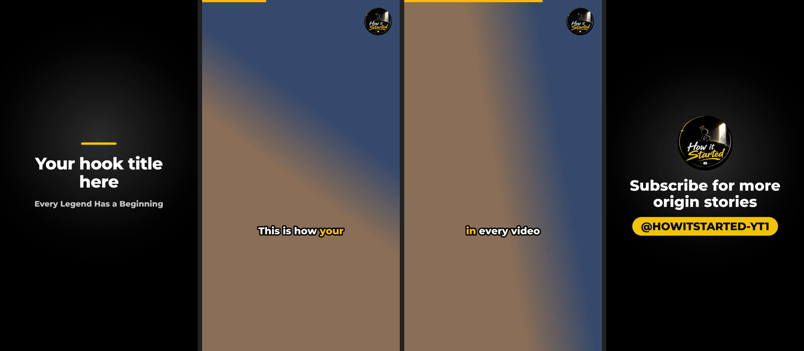

# Brand kits

The owner has **two channels**, each with its own kit:

| Channel | Folder | Look |
|---|---|---|
| How it Started (@HOWITSTARTED-YT1) — origin stories | `brand/` (this folder) | black + yellow, Ottoman animated shorts |
| MindTrace (@MINDTRACEOFFICIAL-YT) — psychology | `brand/mindtrace/` | black + white + red, INKBLOT animated shorts |

Both folders have the same files (`brand.json`, `voice.md`, `logo.png`,
`preview.png`). Tell Claude which channel a video is for ("edit this for
MindTrace"); psychology topics go to MindTrace by default.

## How it Started

Everything here makes every "edit this" video and post look and sound like
**your** channel. Change it once; every new video follows it.

## Fill in (on your phone, in the GitHub app or github.com)
Open `brand/brand.json`, tap the pencil (Edit), change the values, then
**Commit changes**. Or just tell Claude: *"set my brand name to … and my handle to …"*.

| Setting | What it does | Example |
|---|---|---|
| `name` | Channel name; its initials make your logo if you have no logo file | `"Joy Travels"` |
| `handle` | Shown on the outro card | `"@joytravels"` |
| `tagline` | Second line on the intro card | `"Budget travel in 60 seconds"` |
| `colors.background` | Intro/outro background | `"#0b0e14"` |
| `colors.text` | Intro/outro text | `"#ffffff"` |
| `colors.accent` | Bars, logo circle, handle pill | `"#ffe600"` |
| `colors.captionText` / `captionHighlight` | Captions / the word being spoken | `"#ffffff"` / `"#ffe600"` |
| `captions.style` | `creator`, `box`, `classic` or `none` | `"creator"` |
| `intro.enabled` | Intro card when a hook title is given | `true` |
| `outro.enabled`, `outro.text`, `outro.seconds` | End card with your handle (needs a name or handle) | `"Follow for more"`, `2.5` |
| `watermark.enabled`, `position`, `size`, `opacity` | Logo in a corner during the video | `"top-right"`, `0.14`, `0.85` |
| `logo` | Your logo file in this folder (PNG with a transparent background is best) | `"logo.png"` |
| `music.volume` | Music level (0–1) when using `brand/music/` | `0.2` |
| `effects.zoom` | `punch` (zoom in/out at cuts and sentences), `slow` (gentle push-in) or `none` | `"punch"` |
| `effects.sfx` | Whoosh on zooms and B-roll, pop on text pop-ups | `true` |
| `effects.progressBar` | Thin bar at the top in the accent colour | `true` |
| `hashtags` | Always-used hashtags for post copy | `["#travelph", "#budgettravel"]` |

Colours are written as `#` + 6 letters/digits (pick them at htmlcolorcodes.com).
A mistake (for example `"yellow"`) stops the edit with a clear message.

## Other files
- `logo.png` — upload your logo here (optional). Without it, a logo with your
  initials in your colours is made automatically.
- `voice.md` — how your posts should sound; used for titles, descriptions and hashtags.
- `music/` — songs you have the right to use (see `music/README.md`).
- `preview.png` — picture of your look. Make a new one: `node pipeline/brand-preview.mjs`
  (or ask Claude "update my brand preview").
